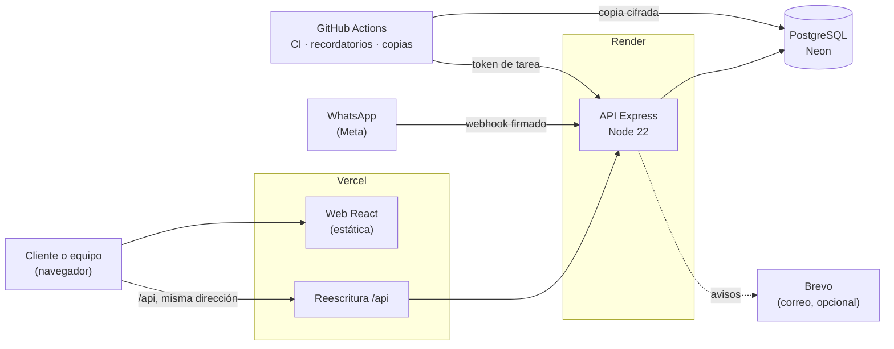
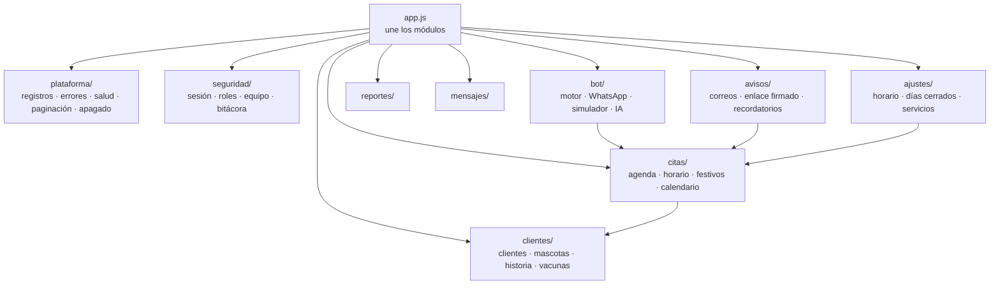
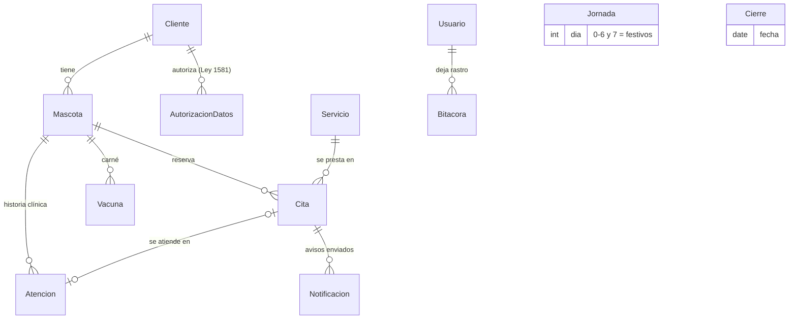
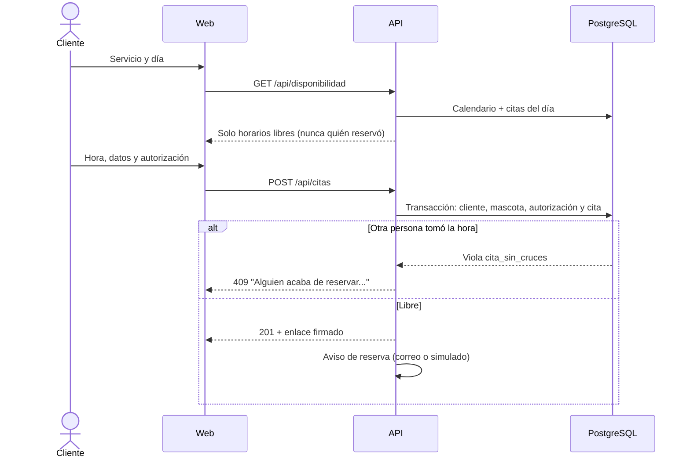

# Arquitectura de Huellitas

Cómo está armado el sistema, por dónde pasa cada petición y dónde vive cada regla. Las razones de cada decisión están en [decisiones.md](decisiones.md).

## Piezas y despliegue

- **La web y la API se ven como un solo sitio.** El navegador llama a `/api` en la misma dirección de la página, y Vercel la reenvía a Render. Por eso la cookie de sesión puede ser `SameSite=Strict` y el CORS no entra en juego.
- **La API no guarda estado en memoria** salvo una copia del horario por un minuto. Se puede reiniciar o duplicar sin perder nada.
- **Tareas programadas fuera de la API:** el plan gratis de Render apaga el servidor sin visitas, así que los recordatorios y las copias los dispara GitHub Actions.

## Módulos de la API

Cada carpeta exporta una función `crearRutasX(prisma, verificarSesion)`. Las reglas viven fuera de las rutas: la página, el panel y el asistente reservan con la misma `crearCita` (`citas/agenda.js`), así que no hay tres versiones de la misma regla.

## Modelo de datos

- **Reglas que garantiza la base de datos, no solo el código:**
  - Dos citas del mismo recurso no se cruzan (`EXCLUDE USING gist`).
  - La bitácora no se puede editar ni borrar (trigger).
  - Horarios y servicios con valores válidos (`CHECK`).
- **Fechas:** se guardan en UTC y se interpretan en hora de Colombia (UTC−5, sin cambio de horario). Los festivos se calculan por año.

## Recorridos principales

### Reservar una cita

### Sesión del panel

1. `POST /api/login` compara con bcrypt, incluso si el correo no existe, para no revelar qué cuentas hay. Tiene límite de intentos por IP y por cuenta.
2. La respuesta pone un JWT `{id, v}` en una cookie `httpOnly`, `Secure` y `SameSite=Strict`, limitada a `/api`.
3. En cada petición se consulta al usuario. Si está inactivo o cambió su `sesionVersion` (cambio de rol, desactivación o cambio de clave), la sesión deja de servir de inmediato.
4. `exigirRol` decide en la API qué ve cada rol. Recepción no recibe la historia clínica: la API no la manda.

### Un cambio de horario

`PUT /api/horario` arma el calendario nuevo en memoria y lo compara con las citas futuras. Si alguna quedaría por fuera, responde 409 con la lista y no guarda nada. Si no, guarda las 8 jornadas en una transacción y limpia la copia en memoria.

## Calidad y operación

| Capa | Qué cubre | Dónde |
|---|---|---|
| Pruebas de la API (Jest + PostgreSQL real) | Reglas, permisos, concurrencia, migraciones | `tests/` |
| Pruebas de pantallas (Vitest) | Reserva, reportes, ajustes, errores | frontend `src/*.test.jsx` |
| De punta a punta (Playwright + axe) | Reserva → panel, permisos, accesibilidad, en computador y celular | frontend `e2e/` |
| Copias de seguridad | Copia cifrada semanal, restauración probada en CI | `scripts/`, [operacion.md](operacion.md) |
| Observabilidad | Registros JSON sin datos personales, id de petición, `/api/salud` | `plataforma/` |
